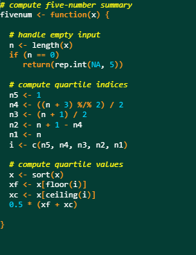

# Chalkboard theme for RStudio

An old-school chalkboard inspired theme for RStudio.

<p align="left">
  
</p>

## Install

Run this in the RStudio console:

```r
rstudioapi::addTheme(
  "https://raw.githubusercontent.com/BMViola/Chalkboard-theme-for-RStudio/main/Chalkboard.tmTheme",
  apply = TRUE
)
```

Or 

```r
source("https://raw.githubusercontent.com/BMViola/Chalkboard-theme-for-RStudio/main/install.R")
```

Or download `Chalkboard.tmTheme` and add it via **Tools → Global Options → Appearance → Add…**

## Colours

| Element            | Colour             |
|--------------------|--------------------|
| Background         | `#043D34`          |
| Text               | `#FFFFFF`          |
| Comments           | `#FFF714` (italic) |
| Strings            | `#FF5252`          |
| Numbers/constants  | `#00D5FF`          |
| Keywords           | `#FD971F` (bold)   |
| Functions          | `#A6E22E`          |
| Function arguments | `#C203FC` (italic) |
